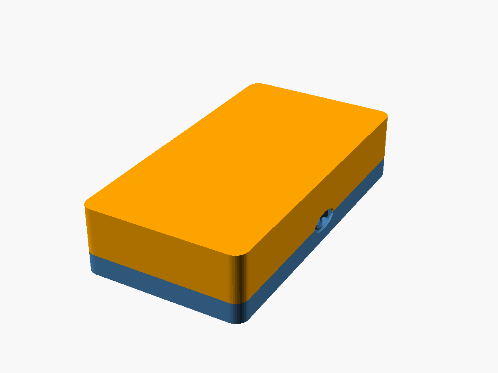
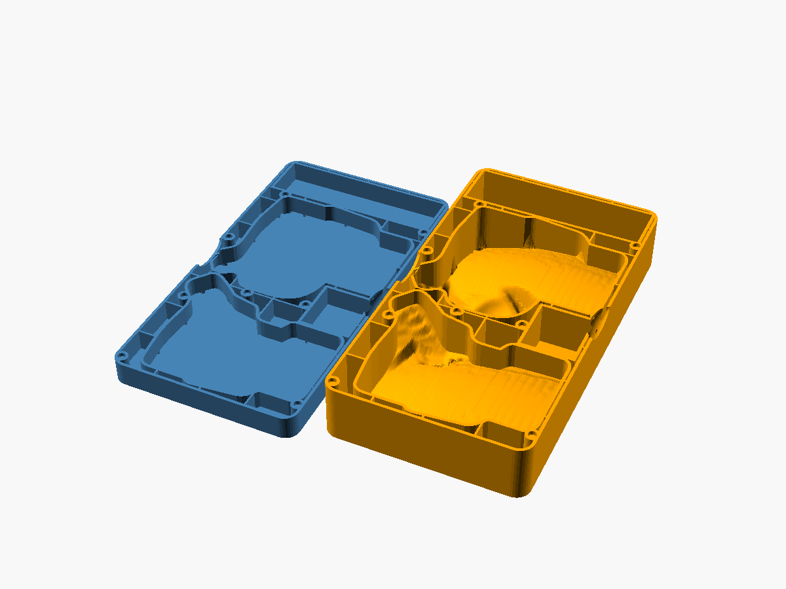

# Combined travel case

One flat case for the whole keyboard: both halves, the display dongle and a 1 m USB cable. It has one base and one lid, and they close with magnets.



## What is inside

| Part | Size or detail |
|---|---|
| Closed case | 161 × 304 × 68 mm |
| Left and right half | Each in its own pocket. The pocket shape is the inside of the original travel case (see [Credits](#credits-and-licence)). |
| Display dongle | Pocket of 41 × 46 mm, 53.5 mm deep. The dongle stands on its rear cap, with the USB-C port down. Unplug the cable first. |
| Cable | Compartment of 149 × 40 mm, about 61 mm deep, across one end. A coiled 1 m cable fits. |
| Magnets | 9 pairs of 6 × 3 mm disc magnets in the surface where base and lid meet. |
| Keycaps | The lid has 1 mm of extra space above the keys. The custom keycaps in [`case/keycaps`](../keycaps) are 8.6–12.7 mm tall. |



## How it is built

The case is hollow, to use less material.

- Every outside surface and every pocket wall is a 2.5 mm thick skin.
- The space between the skins is empty. Ribs every 40 mm keep the skins stiff.
- Each magnet sits in a solid post (11 mm diameter).
- The hollow space is open at the surface where base and lid meet. When the case is closed, you do not see it. When you print in resin or nylon powder, no material is trapped inside.

| | Material volume |
|---|---|
| Base | about 240 cm³ |
| Lid | about 500 cm³ |
| Test frame | about 40 cm³ |

A fully solid version of the same shape needs about 1720 cm³.

## Files

| File | What it is |
|---|---|
| `stl/travel_case_base.stl` | Base, ready to print |
| `stl/travel_case_lid.stl` | Lid, ready to print. It is modelled closed, so turn it upside down in the slicer. |
| `stl/travel_case_test_frame.stl` | Fit test: only the lowest 6 mm of the base walls, without a floor. |
| `combined_case.scad` | OpenSCAD model. Set `part` to `base`, `lid`, `test_frame`, `closed`, `open` or `section`. |
| `case_data.scad` | Generated pocket shapes and positions. Do not edit it by hand. |
| `tools/build_case_data.py` | Writes `case_data.scad` from the original travel case files. |
| `tools/build.py` | Exports the STL files and the preview images. |
| `preview/` | Rendered images |

## Before you order: print the test frame

The fit is not tested with a real keyboard yet. Order or print the test frame first. It is cheap because it is only a thin ring of walls.

1. Put the frame on a table.
2. Place both keyboard halves and the dongle into their openings.
3. Check that each part goes in without force and does not move much.

If a pocket is too tight or too loose, report the place and by how much. The pocket outlines come from the original case, so most changes are in `tools/build_case_data.py`.

## Ordering a print

The parts were made with online print services such as JLCPCB in mind. These services usually set the price by material volume.

| Material | Notes |
|---|---|
| MJF nylon (PA12) | Strong and slightly flexible. A good choice for a case that travels in a bag. |
| SLA resin | Smoother surface, more brittle. |

The skins are 2.5 mm thick, which is above the usual minimum wall thickness of these processes (about 1 mm).

After printing, glue the magnets into the holes (6.3 mm wide, 3.3 mm deep). Check the polarity before the glue sets: each magnet in the lid must attract the magnet below it in the base.

## Rebuilding the files

You need:

- [OpenSCAD](https://openscad.org/downloads.html#snapshots), a 2025 or newer development snapshot. Older versions (2021.01) are too slow for this model.
- Python 3 with `numpy` and `shapely`
- git

```
python tools/build_case_data.py   # downloads the original case, writes case_data.scad
python tools/build.py             # exports stl/ and preview/ (several minutes)
```

Both scripts look for OpenSCAD in `C:\Program Files\OpenSCAD (Nightly)\`. Set the `OPENSCAD` environment variable to use another location.

The main settings are at the top of `tools/build_case_data.py` (wall sizes, cable compartment width, extra space above the keys) and `combined_case.scad` (skin thickness, rib spacing, magnet size, height of the split between base and lid).

## Known limits

- The fit with the real keyboards is not tested.
- The lid pockets follow the inside of the original covers. In the thumb area of the right half the surface is uneven, because the original has the trackball dome there.
- The hollow space is visible when the case is open.

## Credits and licence

The keyboard pockets are taken from the [Charybdis Mini Travel Case](https://github.com/f3rn4nd0d/Charybdis-Mini-Travel-Case) by @CASLArt3D (commit `e74aa3a`). That design uses the Creative Commons Attribution-NonCommercial-ShareAlike 4.0 licence. This remix uses the same licence: [CC BY-NC-SA 4.0](https://creativecommons.org/licenses/by-nc-sa/4.0/). You may share and change it for non-commercial use, if you credit both designs and use the same licence.
