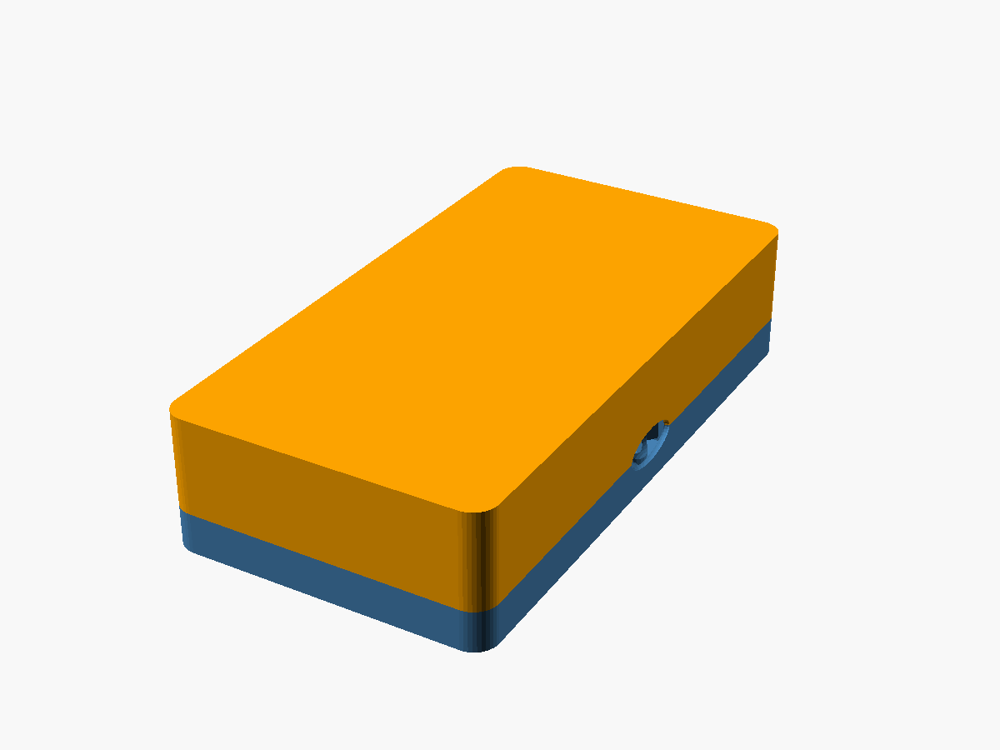
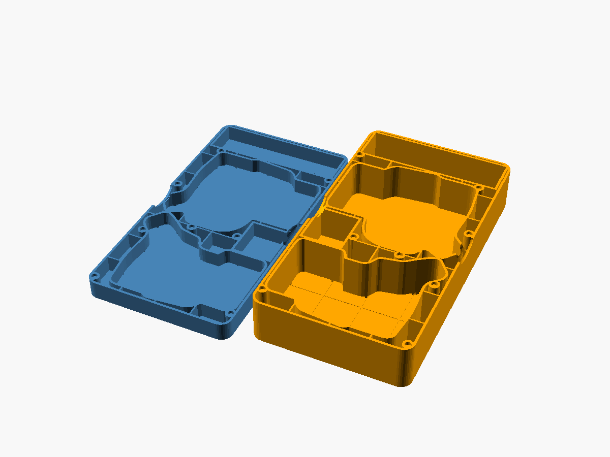

# Combined travel case

One flat case for the whole keyboard: both halves, the display dongle and a 1 m USB cable. It has one base and one lid, and they close with magnets.



## What is inside

| Part | Size or detail |
|---|---|
| Closed case | 163 × 308 × 69 mm |
| Left and right half | Each in its own pocket. In the base, the pocket outline is the inside wall of the original travel case (see [Credits](#credits-and-licence)), plus a 1 mm gap on every side (see [Pocket fit](#pocket-fit)). In the lid, each pocket has a flat ceiling (see [Pocket height](#pocket-height)). |
| Display dongle | Pocket of 41 × 46 mm, 53.5 mm deep. The dongle stands on its rear cap, with the USB-C port down. Unplug the cable first. |
| Cable | Compartment of 151 × 40 mm, about 61 mm deep, across one end. A coiled 1 m cable fits. |
| Magnets | 10 pairs of 6 × 3 mm disc magnets (20 magnets) in the surface where base and lid meet. |
| Keycaps | Made for the custom keycaps in [`case/keycaps`](../keycaps) (8.6–12.7 mm tall). |



## Pocket height

Each lid pocket has a flat ceiling at the highest point of that keyboard half plus 2 mm. The heights are measured on the real keyboard with the custom keycaps, standing on a table:

| Half | Highest point | Room above the pocket floor |
|---|---|---|
| Left | 62 mm (thumb key) | 64 mm |
| Right | 56 mm (keycap and trackball top) | 58 mm |

The original travel case has a curved ceiling that follows a lower keyboard (XDA or HSA keycaps). The custom thumb keys are too tall for it, so this case does not use that ceiling.

The keyboards can move up and down a little inside the case. For a firm fit, glue a few mm of soft foam (for example EVA foam) to the lid ceilings.

With other keycaps, measure the highest point of each half and change `KEYBOARD_HEIGHT` in `tools/build_case_data.py`. Set `CEILING = "original"` to use the curved ceiling of the original case.

## Pocket fit

Each keyboard pocket is 1 mm larger than the original outline on every side (`FIT_GAP` in `tools/build_case_data.py`). The original outlines printed in PETG were too tight: the halves did not go in fully, and the firm plastic was hard to trim. The 4.5 mm divider between the two pockets stays the same.

For a firmer hold, glue thin soft foam to the pocket walls. To change the gap, set `FIT_GAP` and rebuild the files.

## How it is built

The case is hollow, to use less material.

- Every outside surface and every pocket wall is a 2.5 mm thick skin.
- The space between the skins is empty. Ribs every 40 mm keep the skins stiff.
- Each magnet sits in a solid post (11 mm diameter).
- The hollow space is open at the surface where base and lid meet. When the case is closed, you do not see it. When you print in resin or nylon powder, no material is trapped inside.

| | Material volume |
|---|---|
| | Hollow (SLS, MJF, SLA) | Solid (FDM, before infill) |
|---|---|---|
| Base | about 255 cm³ | about 370 cm³ |
| Lid | about 505 cm³ | about 875 cm³ |
| Test frame | – | about 85 cm³ (always solid) |

## Files

| File | What it is |
|---|---|
| `stl/travel_case_base.stl` | Base, hollow, for SLS, MJF or SLA printing |
| `stl/travel_case_lid.stl` | Lid, hollow, for SLS, MJF or SLA printing. It is modelled closed, so turn it upside down in the slicer. |
| `stl/travel_case_base_fdm.stl` | Base, solid, for FDM printing. Print with the floor on the bed. |
| `stl/travel_case_lid_fdm.stl` | Lid, solid, for FDM printing. Already turned over: flat top on the bed, pockets facing up. |
| `stl/travel_case_test_frame.stl` | Fit test: only the lowest 6 mm of the base walls, without a floor. It is solid, so it works for every print process. |
| `combined_case.scad` | OpenSCAD model. Set `part` to `base`, `lid`, `lid_print`, `test_frame`, `closed`, `open` or `section`, and `hollow` to `true` or `false`. |
| `case_data.scad` | Generated pocket shapes and positions. Do not edit it by hand. |
| `tools/build_case_data.py` | Writes `case_data.scad` from the original travel case files. |
| `tools/build.py` | Exports the STL files and the preview images. |
| `preview/` | Rendered images |

## Before you order: print the test frame

The fit is not tested with a real keyboard yet. Order or print the test frame first. It is cheap because it is only a thin ring of walls.

1. Put the frame on a table.
2. Place both keyboard halves and the dongle into their openings.
3. Check that each part goes in without force and does not move much.

If a pocket is too tight or too loose, report the place and by how much. The pocket outlines come from the original case, so most changes are in `tools/build_case_data.py`.

## Ordering a print

There are two sets of files. Choose the set that matches the print process.

### SLS, MJF or SLA (hollow files)

Online services such as JLCPCB usually set the price by material volume, so these files are hollow.

| Material | Notes |
|---|---|
| SLS or MJF nylon (PA12) | Strong and slightly flexible. A good choice for a case that travels in a bag. |
| SLA resin | Smoother surface, more brittle. |

The skins are 2.5 mm thick, which is above the usual minimum wall thickness of these processes (about 1 mm).

### FDM (`_fdm` files)

FDM printers build the part from melted plastic, layer by layer. Do not use the hollow files on FDM: the pocket ceilings of the lid would need support material inside closed hollows. Use the solid `_fdm` files. The slicer fills the inside with infill, so they do not use much more plastic.

| Setting | Value |
|---|---|
| Material | PCTG or PETG (PETG Matte hides layer lines). Avoid PLA: it softens at about 55–60 °C, for example in a car. PLA is fine for the test frame. |
| Orientation | Base: floor on the bed. Lid: flat top on the bed (the `_fdm` file is already turned). |
| Supports | Not needed |
| Walls / infill | 3–4 walls, about 15 % infill |
| Layer height | 0.2 mm |
| Printer size | The parts are 163 × 308 mm, so the bed must be at least about 310 mm in one direction. |

After printing, glue the magnets into the holes (6.3 mm wide, 3.3 mm deep). Check the polarity before the glue sets: each magnet in the lid must attract the magnet below it in the base.

## Rebuilding the files

You need:

- [OpenSCAD](https://openscad.org/downloads.html#snapshots), a 2025 or newer development snapshot. Older versions (2021.01) are too slow for this model.
- Python 3 with `numpy` and `shapely`
- git

```
python tools/build_case_data.py   # downloads the original case, writes case_data.scad
python tools/build.py             # exports stl/ and preview/ (less than a minute)
```

Both scripts look for OpenSCAD in `C:\Program Files\OpenSCAD (Nightly)\`. Set the `OPENSCAD` environment variable to use another location.

The main settings are at the top of `tools/build_case_data.py` (wall sizes, cable compartment width, keyboard heights, ceiling type) and `combined_case.scad` (skin thickness, rib spacing, magnet size, height of the split between base and lid).

## Known limits

- The outline fit is not tested with the real keyboards yet. Use the test frame.
- The pocket heights come from measurements with a ruler (about ±1 mm). The 2 mm headroom covers that.
- The hollow space is visible when the case is open.

## Credits and licence

The keyboard pockets are taken from the [Charybdis Mini Travel Case](https://github.com/f3rn4nd0d/Charybdis-Mini-Travel-Case) by @CASLArt3D (commit `e74aa3a`). That design uses the Creative Commons Attribution-NonCommercial-ShareAlike 4.0 licence. This remix uses the same licence: [CC BY-NC-SA 4.0](https://creativecommons.org/licenses/by-nc-sa/4.0/). You may share and change it for non-commercial use, if you credit both designs and use the same licence.
